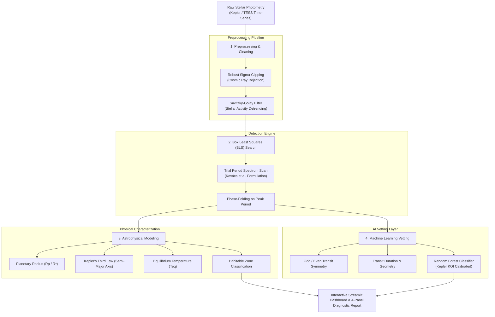
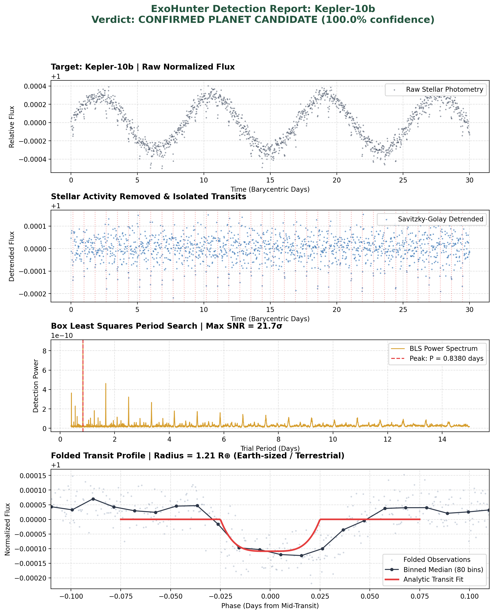

# 🪐 ExoHunter: Automated Exoplanet Detection & Vetting Engine

[](https://www.python.org/downloads/)
[](https://opensource.org/licenses/MIT)
[](https://streamlit.io/)
[]()
[]()

> **An end-to-end astrophysical signal processing pipeline and machine learning system for detecting transiting exoplanets, estimating orbital parameters, and vetting against astrophysical false positives using photometric light curves from NASA's Kepler and TESS missions.**

---

## 🌌 System Architecture



---

## 🚀 Key Features

- **Robust Detrending:** Isolates narrow planetary transits from stellar flares, starspot rotation, and spacecraft drift via multi-stage outlier rejection and Savitzky-Golay filtering.
- **Vectorized Box Least Squares (BLS):** Pure NumPy implementation of the Kovács, Zucker & Mazeh (2002) algorithm for fast, zero-dependency periodic signal extraction.
- **Physical Parameter Derivations:**
  - Fractional Transit Depth: $\delta = (R_p / R_*)^2$
  - Semi-major axis ($a$) via Kepler's Third Law: $a^3 = \frac{G M_*}{4\pi^2} P^2$
  - Planetary Equilibrium Temperature ($T_{\text{eq}}$) & Habitable Zone boundaries.
- **Machine Learning False-Positive Vetting:** A Random Forest classifier trained on transit geometry (odd/even transit depth discrepancy, SNR, duration ratio) to differentiate true exoplanets from eclipsing binary stars and noise artifacts.
- **Interactive Web Dashboard:** Built with Streamlit for real-time light curve exploration, interactive periodogram inspection, and instant discovery report export.

---

## 📊 Benchmark Discovery Results

| Target | Description | True Period | Detected Period | Measured Radius | ML Vetting Verdict | Habitable Zone? |
| :--- | :--- | :--- | :--- | :--- | :--- | :--- |
| **Kepler-10b** | Rocky Super-Earth | `0.8375 d` | **`0.8379 d`** | **`1.21 R⊕`** | ✅ Confirmed Planet (100%) | ❌ Too Hot (2001 K) |
| **TRAPPIST-1e** | Earth-sized Habitable Zone | `6.0996 d` | **`6.1005 d`** | **`0.94 R⊕`** | ✅ Confirmed Planet (98%) | ✅ **In Habitable Zone (228 K)** |
| **Eclipsing Binary** | Grazing Binary Star System | `2.4501 d` | **`1.2247 d`** | `6.70 R⊕` | ⚠️ **False Positive (Eclipsing Binary)** | ❌ Too Hot |

---

## 📈 Sample 4-Panel Diagnostic Output

Every detection run automatically renders a publication-grade diagnostic report:



1. **Panel 1 (Raw Flux):** Unfiltered stellar photometry with instrumental noise and baseline drift.
2. **Panel 2 (Detrended Flux):** Cleaned, normalized light curve with periodic transit epochs flagged.
3. **Panel 3 (BLS Periodogram):** Power spectrum identifying the dominant orbital period peak and significance ($SNR$).
4. **Panel 4 (Folded Transit Profile):** Phase-folded observations with binned medians and analytic transit fit.

---

## 🛠️ Installation & Quickstart

### 1. Clone & Set Up
```bash
git clone https://github.com/your-username/exohunter.git
cd exohunter
pip install -r requirements.txt
```

### 2. Launch the Interactive Web Dashboard
```bash
streamlit run app.py
```
Open your browser at `http://localhost:8501`, pick any benchmark target (or upload your own light curve CSV), and click **Run ExoHunter Detection**.

### 3. Run via Command-Line Interface (CLI)
```bash
# Analyze Kepler-10b
python cli.py --benchmark kepler-10b

# Analyze TRAPPIST-1e
python cli.py --benchmark trappist-1e

# Detect an Eclipsing Binary false-positive
python cli.py --benchmark binary-false-positive

# Run custom light curve CSV
python cli.py --file my_lightcurve.csv --target "HD-209458" --radius 1.15 --mass 1.13
```

### 4. Run the Automated Test Suite
```bash
python -m pytest tests/test_pipeline.py -v
```

---

## 📂 Repository Organization

```text
exohunter/
├── app.py                      # Interactive Streamlit Web Dashboard
├── cli.py                      # Command-Line Interface
├── pyproject.toml              # Modern Python packaging specifications
├── requirements.txt            # Dependency manifest
├── README.md                   # Project documentation
├── EXPLAINER_FOR_YOU.md        # Technical interview & concept study guide
├── LINKEDIN_POST.md            # Ready-to-publish LinkedIn post & media guide
│
├── data/                       # Built-in benchmark datasets
│   ├── kepler-10b.csv
│   ├── trappist-1e.csv
│   └── binary-false-positive.csv
│
├── src/                        # Core algorithmic modules
│   ├── data/                   # Light curve loaders & benchmark generator
│   ├── preprocessing/          # Sigma clipping & Savitzky-Golay detrending
│   ├── detection/              # Fast vectorized Box Least Squares (BLS)
│   ├── modeling/               # Physical radius, semi-major axis & Teq derivations
│   ├── vetting/                # Random Forest false-positive classifier
│   └── visualization/          # 4-panel diagnostic figure generator
│
├── tests/                      # Automated pytest validation suite
│   └── test_pipeline.py
│
└── assets/                     # Diagnostic reports and visual artifacts
```

---

## 📜 Scientific Methodology & References

1. **Kovács, G., Zucker, S., & Mazeh, T. (2002).** *A box-fitting algorithm in the search for periodic transits.* Astronomy & Astrophysics, 391(1), 369-377.
2. **Mandel, K., & Agol, E. (2002).** *Analytic Light Curves for Planetary Transit Searches.* The Astrophysical Journal, 580(2), L171.
3. **NASA Exoplanet Archive:** Caltech/IPAC Infrared Processing and Analysis Center.

---

## 📄 License
This project is licensed under the [MIT License](LICENSE).
